<picture>
  <source media="(prefers-color-scheme: dark)" srcset="assets/hero-dark.svg">
  
</picture>

  <a href="https://ali-shaikh.vercel.app">Portfolio</a> &nbsp;·&nbsp;
  <a href="https://www.linkedin.com/in/ali-shaikhh/">LinkedIn</a> &nbsp;·&nbsp;
  <a href="mailto:alishaikhh15@gmail.com">Email</a> &nbsp;·&nbsp;
  <a href="https://ali-shaikh.vercel.app/resume.pdf">Resume</a>

I build AI products that hold up outside a notebook: retrieval systems, LLM agents, and the APIs and interfaces around them. Computer Engineering, University of Mumbai (2026). Co-founder of ArcadeOps, a cloud learning community of 2,000+ developers.

### Selected work

| Project | Description | Stack |
|:--|:--|:--|
| **FarmChain** | Agricultural marketplace with a RAG-based advisory layer for farmers | Node.js, Express, MongoDB, LangChain |
| **Quizzora** | Turns lectures, audio and documents into quizzes and summaries using coordinated LLM agents | Python, GPT-4, Whisper |
| **Querify** | Ask questions of a CSV in plain English and get the SQL that answers them | Python, LangChain, OpenAI |
| **PlanForge** | Converts floor-plan images into editable AutoCAD DXF files | JavaScript, Anthropic API |
| **Innovation Furniture** | E-commerce platform for a furniture and interiors brand | React, Next.js, Tailwind |
| **CO-LAB Vault** | Project and resource management for small teams | Next.js, React, Tailwind |

### Stack

**AI / ML** &nbsp; PyTorch · TensorFlow · LangChain · Hugging Face · OpenAI · FAISS · Pinecone · ChromaDB · YOLOv8 
**Backend** &nbsp; Python · FastAPI · Flask · Django · Node.js · Express 
**Frontend** &nbsp; React · Next.js · Tailwind CSS · Streamlit 
**Cloud & data** &nbsp; GCP (Vertex AI, Cloud Run, BigQuery) · AWS · MongoDB · SQL

### Experience

**Co-founder**, ArcadeOps Community &nbsp;2024 – present 
**Co-facilitator**, Google Cloud Arcade, GCAF25 &nbsp;2025

 

